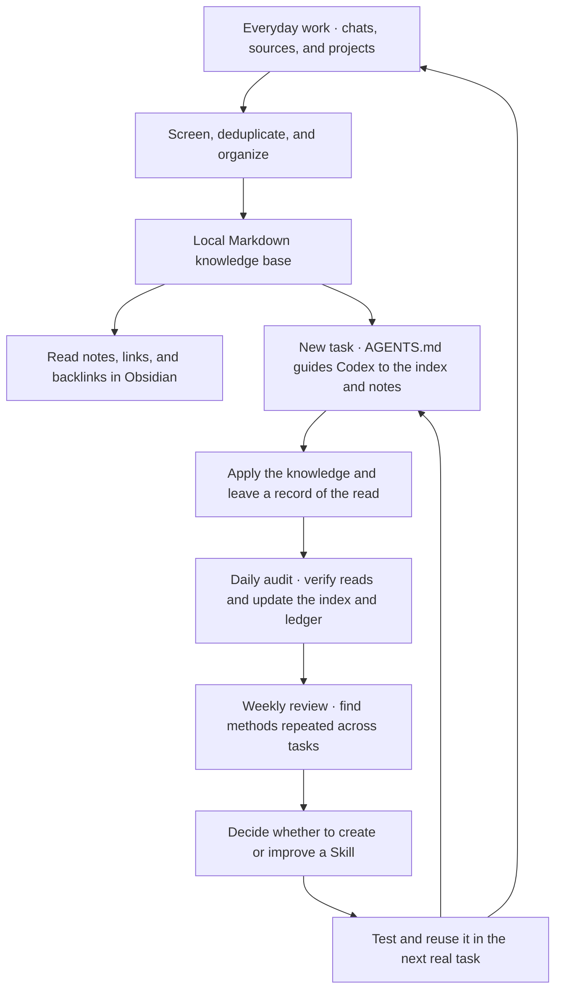

# LifeOS Knowledge

[简体中文](README.zh-CN.md)

LifeOS is an AI-led knowledge management system that grows through use. Codex captures useful knowledge from everyday work, draws on it in future tasks, and uses evidence from those tasks to identify methods worth turning into reusable Skills.

## How LifeOS works



### 1. Capture knowledge from everyday work

Ask Codex to save a useful insight from a conversation, source, or project. You can also set up daily knowledge capture to review new conversation material within a scope you approve. Codex screens for future value, checks the index and related notes, and adds meaningful evidence to existing notes where it fits. Source material goes into Sources, developing ideas into Notes, and reusable knowledge into the Wiki. `INDEX.md` gives you an entry point.

The notes live as local Markdown files. Open the same folder in Obsidian to read them, follow links, and see which other notes link back.

### 2. Apply the knowledge in real tasks

Add the rule to your global or project `AGENTS.md` and supply your vault path. At the start of a task, Codex considers whether your vault has relevant context, methods, or experience. It checks `INDEX.md`, reads relevant notes, and traces claims to their sources when needed. For example, a note on analyzing user feedback can help Codex separate observations, possible explanations, and a next check before drawing a conclusion. [Copy the setup rule](plugins/lifeos-knowledge/skills/lifeos-knowledge-base/assets/vault/SETUP.md)

### 3. Turn repeated use into reusable Skills

- **Check what was used each day.** The daily reuse audit reviews the previous full calendar day. It verifies which Wiki notes were read, in which tasks, and how they were used. Verified counts go into `INDEX.md`, with task context and evidence in the ledger. Rescanning the same read adds nothing.
- **Review recurring methods each week.** The weekly review starts with the daily counts and checks independent tasks and actual outputs. If two projects both used the same steps to separate observations from competing explanations and design a follow-up check, Codex compares the evidence and looks at existing Skills. It can suggest creating a Skill, improving an existing one, or keeping the method as a Wiki note.
- **Test the method in the next task.** Once you choose a change, the Skill can capture the trigger, inputs, steps, and acceptance checks. Its next real use can produce evidence to improve the notes or the Skill.

## What's included

| Skill | What it does |
| --- | --- |
| Build and use a knowledge base | Initialize a Markdown vault, capture and deduplicate notes, and use them in tasks |
| Track knowledge reuse | Verify reads, preview changes, and update the index and ledger |
| Review Skill candidates | Compare actual tasks and existing Skills, then propose improvements for your review |

The scheduling guides cover [daily knowledge capture](plugins/lifeos-knowledge/guides/01-daily-knowledge-capture.md), [daily reuse statistics](plugins/lifeos-knowledge/guides/02-daily-reuse-statistics.md), and [weekly Skill review](plugins/lifeos-knowledge/guides/03-weekly-skill-review.md). Try them manually first, then choose your schedules, authorized sources, and vault. The reuse collector recognizes explicit single-file `cat` reads with a matching note body in selected local Codex JSONL records.

## Install in Codex

Use the Codex CLI. The vault and reuse scripts require Python 3.11 or later.

```sh
codex plugin marketplace add gilbertwuu/lifeos-knowledge@v0.1.1
codex plugin add lifeos-knowledge@lifeos-knowledge
```

Open **LifeOS Knowledge** in Codex Desktop and start a new chat. Ask it to initialize a LifeOS vault in an empty folder you choose. Save one note, then start a separate task to check whether Codex finds and uses it.

You can also [download the ZIP](https://github.com/gilbertwuu/lifeos-knowledge/releases/download/v0.1.1/lifeos-knowledge-0.1.1.zip). Unzip it and pass the extracted folder to the first command in place of the GitHub address.
