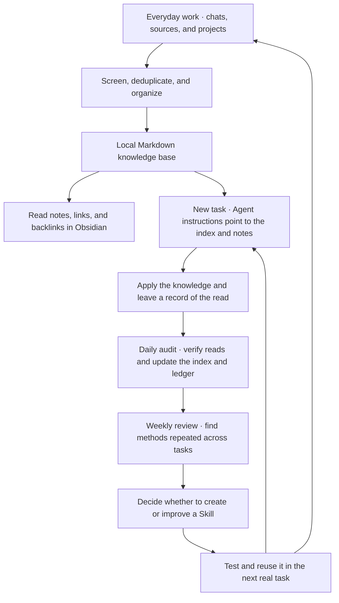
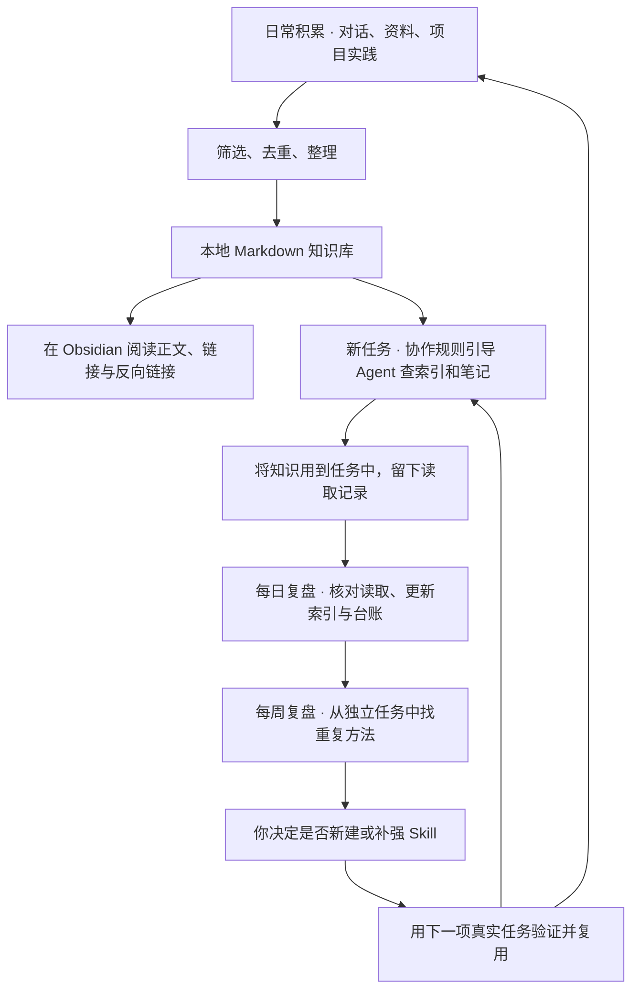

# LifeOS Knowledge

[简体中文](#简体中文)

LifeOS is an AI-led knowledge management system that grows through use. Your Agent captures useful knowledge from everyday work, draws on it in future tasks, and uses evidence from those tasks to identify methods worth turning into reusable Skills.

## How LifeOS works

### 1. Capture knowledge from everyday work

Ask your Agent to save a useful insight from a conversation, source, or project. You can also set up daily knowledge capture to review new conversation material within a scope you approve. The Agent screens for future value, checks the index and related notes, and adds meaningful evidence to existing notes where it fits. Source material goes into Sources, developing ideas into Notes, and reusable knowledge into the Wiki. `INDEX.md` gives you an entry point.

The notes live as local Markdown files. Open the same folder in Obsidian to read them, follow links, and see which other notes link back.

### 2. Apply the knowledge in real tasks

Add a knowledge lookup rule to your Agent’s persistent instructions. Use `AGENTS.md` if your tool reads it, or use the tool’s project or global instruction settings. At the start of a task, the Agent considers whether your vault has relevant context, methods, or experience. It checks `INDEX.md`, reads the relevant notes, and traces claims to their sources when needed. For example, a note on analyzing user feedback can help separate observations, possible explanations, and a next check before drawing a conclusion.

### 3. Turn repeated use into reusable Skills

- **Check what was used each day.** The daily reuse audit reviews the previous full calendar day. It verifies which Wiki notes were read, in which tasks, and how they were used. Verified counts go into `INDEX.md`, with task context and evidence in the ledger. Rescanning the same read adds nothing.
- **Review recurring methods each week.** The weekly review starts with the daily counts and checks independent tasks and actual outputs. If two projects both used the same steps to separate observations from competing explanations and design a follow-up check, the Agent compares the evidence and looks at existing Skills. It can suggest creating a Skill, improving an existing one, or keeping the method as a Wiki note.
- **Test the method in the next task.** Once you choose a change, the Skill can capture the trigger, inputs, steps, and acceptance checks. Its next real use can produce evidence to improve the notes or the Skill.

## What's included

| Skill | What it does |
| --- | --- |
| Build and use a knowledge base | Initialize a Markdown vault, capture and deduplicate notes, and use them in tasks |
| Track knowledge reuse | Verify reads, preview changes, and update the index and ledger |
| Review Skill candidates | Compare actual tasks and existing Skills, then propose improvements for your review |

The scheduling guides cover [daily knowledge capture](plugins/lifeos-knowledge/skills/lifeos-knowledge-base/references/daily-capture.md), [daily reuse statistics](plugins/lifeos-knowledge/skills/lifeos-wiki-reuse/references/daily-reuse.md), and [weekly Skill review](plugins/lifeos-knowledge/skills/lifeos-skill-review/references/weekly-review.md). Use their prompts as a starting point. Configure schedules and record access in the tool you use, or run the prompts manually.

## Install the three Skills

1. [Download the single ZIP](https://github.com/gilbertwuu/lifeos-knowledge/releases/download/v0.2.0/lifeos-knowledge-0.2.0.zip) and extract it. The [three Skill folders](plugins/lifeos-knowledge/skills) each include a `SKILL.md` and their own resources.
2. Copy each complete folder into your tool's Skill directory or import it using your tool's Skill manager. If your tool has no Skill loader, give the Agent the relevant `SKILL.md` and its linked resources as task instructions. See the [installation and compatibility guide](docs/compatibility.md).
3. Start a new session. Ask the Agent to initialize a vault, add the [knowledge lookup rule](plugins/lifeos-knowledge/skills/lifeos-knowledge-base/assets/vault/SETUP.md), and try one capture and lookup before scheduling anything.

### What can run automatically

| Task | Scheduled when the tool can access | Manual fallback |
| --- | --- | --- |
| [Daily capture](plugins/lifeos-knowledge/skills/lifeos-knowledge-base/references/daily-capture.md) | Conversation records, vault and checkpoint | Provide an excerpt or export, then save the proposed changes if needed |
| [Daily reuse](plugins/lifeos-knowledge/skills/lifeos-wiki-reuse/references/daily-reuse.md) | Evidence of actual reads and use, plus a writable ledger | Supply task evidence and record verified reads in a Markdown ledger |
| [Weekly review](plugins/lifeos-knowledge/skills/lifeos-skill-review/references/weekly-review.md) | Daily ledger or export, actual task outputs, existing Skills and report folder | Provide the evidence and run the review prompt in a chat |

The optional collector supports matching local Codex records. Every Skill also has a file-based workflow. The weekly review proposes changes for you to decide.

---

## 简体中文

[English](#lifeos-knowledge)

LifeOS 是一套由 AI 主导、在使用中不断生长的知识管理系统。AI 从日常工作中筛出值得留下的知识，在下一次任务里用上它，再根据真实的使用记录，把反复用到的做法整理成可调用的 Skill。

## LifeOS 怎样运转

### 1. 从日常积累到本地知识库

把对话、资料和项目实践中的收获交给你的 Agent。你可以随手请它保存，也可以设置「每日知识沉淀」，让 AI 在你授权的范围内回看当天新增的对话内容。AI 先判断内容将来能不能帮助判断、创作或解决问题，再查索引和相关正文，优先给已有笔记补充新证据。原始材料、还在思考的问题、已经可以复用的方法分别存入 Sources、Notes 和 Wiki，并通过 `INDEX.md` 找到入口。

笔记是本地 Markdown 文件。用 Obsidian 打开同一个文件夹，就能阅读正文、沿链接找到相关笔记，也能从反向链接查看还有哪些笔记引用了它。

### 2. 从知识库到真实任务

把查库规则写进你所用 Agent 的长期指令。工具会读取 `AGENTS.md` 时，可以写在这个文件里。也可以用该工具提供的项目指令或全局指令。新任务开始时，Agent 先判断库里的背景、方法或经验能不能帮上忙。有相关内容时，它先看 `INDEX.md`，再读笔记正文，必要时追溯来源。比如分析用户反馈时，AI 可以用库里的方法把已观察的现象、可能的解释和下一步核对分开，再结合当前证据给出判断。

### 3. 从使用记录到可复用的 Skill

- **每天核对用过什么。** 每日复用统计回看前一个完整自然日，核对哪些 Wiki 真的读了正文、在什么任务里派上了什么用场。确认后把计数写入 `INDEX.md`，把用途和证据留在台账里。反复扫描同一条读取记录只记一次。
- **每周判断哪些做法值得留下。** 周回顾先看每日统计，再回查独立任务和实际输出。比如两个不同项目都在用「先列观察，再提出竞争解释，最后设计核对」，AI 会比较它们的步骤和验收，并查看现有 Skill 是否已覆盖。建议可能是新建 Skill、补强已有 Skill，或继续把方法保留为 Wiki。
- **用下一项任务检验。** 你决定采纳后，把触发条件、所需资料、步骤和验收标准写进 Skill。下一次遇到相似任务，就能按场景调用。实际使用留下的新证据，又能用于补充笔记或改进 Skill。

## 插件提供什么

| 入口 | 用途 |
| --- | --- |
| 知识库搭建与使用 | 初始化 Markdown 库、筛选入库、查重、查找和使用笔记 |
| 知识复用统计 | 核对读取证据、预览并更新索引与台账 |
| Skill 沉淀周回顾 | 比较真实任务和现有 Skill，形成供你决定的建议 |

三份定时任务指南分别是[每日知识沉淀](plugins/lifeos-knowledge/skills/lifeos-knowledge-base/references/daily-capture.md)、[每日复用统计](plugins/lifeos-knowledge/skills/lifeos-wiki-reuse/references/daily-reuse.md)和[每周 Skill 回顾](plugins/lifeos-knowledge/skills/lifeos-skill-review/references/weekly-review.md)。里面的任务说明可以直接手动使用，也可以按你所用工具的定时方式和资料权限调整。

## 接入三个 Skill

1. [下载同一个 ZIP](https://github.com/gilbertwuu/lifeos-knowledge/releases/download/v0.2.0/lifeos-knowledge-0.2.0.zip)并解压。[三个 Skill 目录](plugins/lifeos-knowledge/skills)各自包含 `SKILL.md` 和需要的资源。
2. 按你的工具要求，把每个完整目录复制到 Skill 目录或用工具的导入功能接入。如果工具没有 Skill 加载功能，可以把对应的 `SKILL.md` 和它引用的材料作为任务指令交给 Agent。[安装与兼容性说明](docs/compatibility.zh-CN.md)
3. 新开对话，请 Agent 初始化一个测试库，按[接入说明](plugins/lifeos-knowledge/skills/lifeos-knowledge-base/assets/vault/SETUP.md)添加查库规则，先试一次保存和调用，再设置定时任务。

### 哪些可以自动运行

| 任务 | 定时运行需要能访问 | 手动做法 |
| --- | --- | --- |
| [每日知识沉淀](plugins/lifeos-knowledge/skills/lifeos-knowledge-base/references/daily-capture.md) | 对话正文、知识库和检查点 | 提供对话摘录或导出，必要时自己保存整理结果 |
| [每日复用统计](plugins/lifeos-knowledge/skills/lifeos-wiki-reuse/references/daily-reuse.md) | 实际读取和采用的证据，以及可写的台账 | 提供原任务证据，把核实的读取记到 Markdown 台账 |
| [每周 Skill 回顾](plugins/lifeos-knowledge/skills/lifeos-skill-review/references/weekly-review.md) | 日台账或导出、实际任务产物、现有 Skill 和报告位置 | 提供证据后在对话中运行回顾提示词 |

包内附有可选的 Codex 日志采集器。三个 Skill 都提供用普通文件执行的步骤，周回顾形成建议，由你决定是否改造 Skill。
