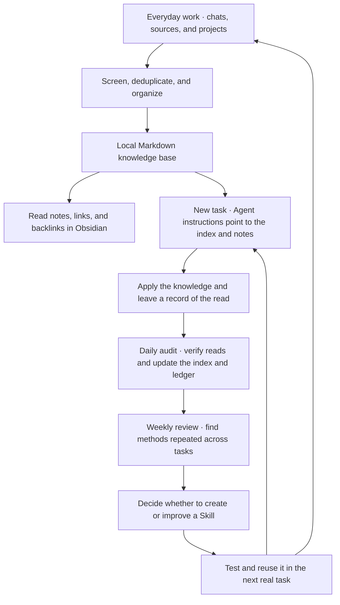

# LifeOS Knowledge

[简体中文](README.zh-CN.md)

LifeOS is an AI-led knowledge management system that grows through use. Your Agent captures useful knowledge from everyday work, draws on it in future tasks, and uses evidence from those tasks to identify methods worth turning into reusable Skills.

## How LifeOS works



### 1. Capture knowledge from everyday work

Ask your Agent to save a useful insight from a conversation, source, or project. You can also set up daily knowledge capture to review new conversation material within a scope you approve. The Agent screens for future value, checks the index and related notes, and adds meaningful evidence to existing notes where it fits. Source material goes into Sources, developing ideas into Notes, and reusable knowledge into the Wiki. `INDEX.md` gives you an entry point.

The notes live as local Markdown files. Open the same folder in Obsidian to read them, follow links, and see which other notes link back.

### 2. Apply the knowledge in real tasks

Add a knowledge lookup rule to your Agent’s persistent instructions. Use `AGENTS.md` if your tool reads it, or use the tool’s project or global instruction settings. At the start of a task, the Agent considers whether your vault has relevant context, methods, or experience. It checks `INDEX.md`, reads the relevant notes, and traces claims to their sources when needed. For example, a note on analyzing user feedback can help separate observations, possible explanations, and a next check before drawing a conclusion.

### 3. Turn repeated use into reusable Skills

- **Check what was used each day.** The daily reuse audit reviews the previous full calendar day. It verifies which Wiki notes were read, in which tasks, and how they were used. Verified counts go into `INDEX.md`, with task context and evidence in the ledger. Rescanning the same read adds nothing.
- **Review recurring methods each week.** The weekly review starts with the daily counts and checks independent tasks and actual outputs. If two projects both used the same steps to separate observations from competing explanations and design a follow-up check, the Agent compares the evidence and looks at existing Skills. It can suggest creating a Skill, improving an existing one, or keeping the method as a Wiki note.
- **Test the method in the next task.** Once you choose a change, the Skill can capture the trigger, inputs, steps, and acceptance checks. Its next real use can produce evidence to improve the notes or the Skill.

## What's included

| Skill | What it does |
| --- | --- |
| Build and use a knowledge base | Initialize a Markdown vault, capture and deduplicate notes, and use them in tasks |
| Track knowledge reuse | Verify reads, preview changes, and update the index and ledger |
| Review Skill candidates | Compare actual tasks and existing Skills, then propose improvements for your review |

The scheduling guides cover [daily knowledge capture](plugins/lifeos-knowledge/guides/01-daily-knowledge-capture.md), [daily reuse statistics](plugins/lifeos-knowledge/guides/02-daily-reuse-statistics.md), and [weekly Skill review](plugins/lifeos-knowledge/guides/03-weekly-skill-review.md). Use their prompts as a starting point. Configure schedules and record access in the tool you use, or run the prompts manually.

## Get started with your Agent

1. **Create a vault.** Copy the contents of the [Markdown vault template](plugins/lifeos-knowledge/skills/lifeos-knowledge-base/assets/vault) into a local folder you choose. Give your Agent access to that folder.
2. **Connect it to your work.** Add the rule below to your Agent's instructions and fill in the vault path. If your Agent only has access to uploaded files, share the relevant files in each task and save updates to the vault yourself.
3. **Try one cycle.** Save a note with its source. In a fresh task, check that the Agent finds and applies it. To start a reuse record manually, write down the date, task, note path, and how the note helped. Review those records weekly and compare them with actual work before proposing a Skill.

```text
My knowledge base is at <absolute path to my vault>.
Before a task, consider whether the vault contains relevant context or methods. If it does, read INDEX.md, then the relevant notes. Apply what fits the task and briefly say what you used. If nothing applies, continue with the task.
When I ask you to save knowledge, follow MEMORY.md and update INDEX.md.
```

Plugin installation, scheduled runs, and automatic reuse tracking depend on your Agent's capabilities and record format. The [compatibility guide](docs/compatibility.md) covers the verified installation and the manual workflow.
