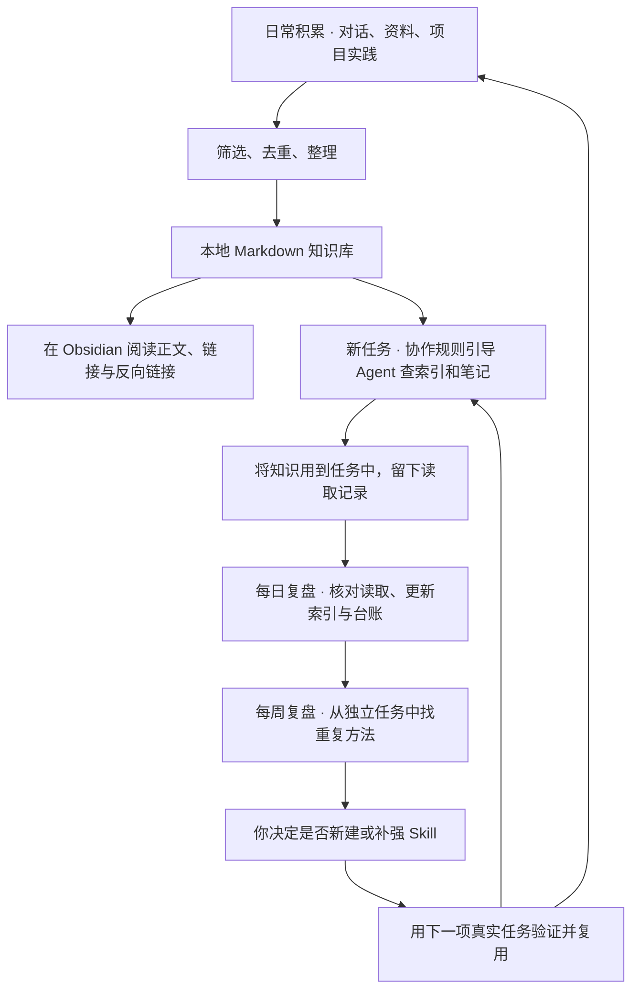

# LifeOS 知识管理

[English](README.md)

LifeOS 是一套由 AI 主导、在使用中不断生长的知识管理系统。AI 从日常工作中筛出值得留下的知识，在下一次任务里用上它，再根据真实的使用记录，把反复用到的做法整理成可调用的 Skill。

## LifeOS 怎样运转



### 1. 从日常积累到本地知识库

把对话、资料和项目实践中的收获交给你的 Agent。你可以随手请它保存，也可以设置「每日知识沉淀」，让 AI 在你授权的范围内回看当天新增的对话内容。AI 先判断内容将来能不能帮助判断、创作或解决问题，再查索引和相关正文，优先给已有笔记补充新证据。原始材料、还在思考的问题、已经可以复用的方法分别存入 Sources、Notes 和 Wiki，并通过 `INDEX.md` 找到入口。

笔记是本地 Markdown 文件。用 Obsidian 打开同一个文件夹，就能阅读正文、沿链接找到相关笔记，也能从反向链接查看还有哪些笔记引用了它。

### 2. 从知识库到真实任务

把查库规则写进你所用 Agent 的长期指令。工具会读取 `AGENTS.md` 时，可以写在这个文件里。也可以用该工具提供的项目指令或全局指令。新任务开始时，Agent 先判断库里的背景、方法或经验能不能帮上忙。有相关内容时，它先看 `INDEX.md`，再读笔记正文，必要时追溯来源。比如分析用户反馈时，AI 可以用库里的方法把已观察的现象、可能的解释和下一步核对分开，再结合当前证据给出判断。

### 3. 从使用记录到可复用的 Skill

- **每天核对用过什么。** 每日复用统计回看前一个完整自然日，核对哪些 Wiki 真的读了正文、在什么任务里派上了什么用场。确认后把计数写入 `INDEX.md`，把用途和证据留在台账里。反复扫描同一条读取记录只记一次。
- **每周判断哪些做法值得留下。** 周回顾先看每日统计，再回查独立任务和实际输出。比如两个不同项目都在用「先列观察，再提出竞争解释，最后设计核对」，AI 会比较它们的步骤和验收，并查看现有 Skill 是否已覆盖。建议可能是新建 Skill、补强已有 Skill，或继续把方法保留为 Wiki。
- **用下一项任务检验。** 你决定采纳后，把触发条件、所需资料、步骤和验收标准写进 Skill。下一次遇到相似任务，就能按场景调用。实际使用留下的新证据，又能用于补充笔记或改进 Skill。

## 插件提供什么

| 入口 | 用途 |
| --- | --- |
| 知识库搭建与使用 | 初始化 Markdown 库、筛选入库、查重、查找和使用笔记 |
| 知识复用统计 | 核对读取证据、预览并更新索引与台账 |
| Skill 沉淀周回顾 | 比较真实任务和现有 Skill，形成供你决定的建议 |

三份定时任务指南分别是[每日知识沉淀](plugins/lifeos-knowledge/guides/01-daily-knowledge-capture.md)、[每日复用统计](plugins/lifeos-knowledge/guides/02-daily-reuse-statistics.md)和[每周 Skill 回顾](plugins/lifeos-knowledge/guides/03-weekly-skill-review.md)。里面的任务说明可以直接手动使用，也可以按你所用工具的定时方式和资料权限调整。

## 用你的 Agent 开始

1. **准备知识库。** 把 [Markdown 知识库模板](plugins/lifeos-knowledge/skills/lifeos-knowledge-base/assets/vault)的内容复制到你选定的本地文件夹，并让 Agent 能访问它。
2. **接入日常任务。** 把下面的规则加到 Agent 的协作指令，填入库路径。如果工具只能读取上传的文件，就在任务里提供相关文件，更新后自行保存回本地库。
3. **试跑一次。** 先保存一条带来源的笔记，再开一个新任务，看看 Agent 是否主动找到并用上它。复用记录可以先手工记下日期、任务、笔记路径和实际用途。每周对照任务产出回顾这些记录，再判断哪些做法值得做成 Skill。

```text
我的知识库位于 <知识库的绝对路径>。
开始任务前，先判断知识库有没有相关背景或方法。有明确用途时，先读 INDEX.md，再读相关笔记正文。把适用内容用到任务里，简短说明用到了什么。找不到适用笔记时继续做任务。
当我要求保存知识时，按 MEMORY.md 的规则整理，并更新 INDEX.md。
```

插件安装、定时触发和自动统计取决于工具提供的能力与记录格式。已验证的安装方式和手动跑法见[兼容性说明](docs/compatibility.zh-CN.md)。
