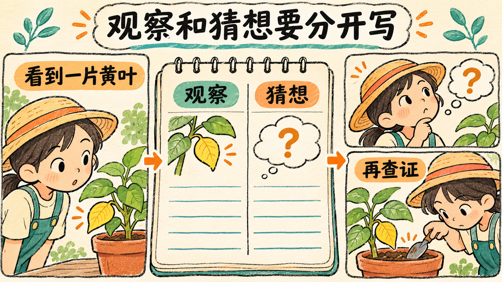

# 观察和猜想要分开写

> [!abstract] 一句话看懂
> 先写自己看见了什么，再单独写可能的解释。下次回来，就知道要查证哪件事。

假设你第一次照料一盆植物，今天发现一片叶子发黄。写下“一片黄叶”保留了一条观察。如果直接写成“这盆植物缺水了”，以后翻笔记就很难分清，当时看到的到底是叶片的颜色，还是已经核实过的缺水现象。

这次可以这样记：

| 观察 | 猜想 | 接下来可以核对什么 |
| --- | --- | --- |
| 今天看到一片黄叶 | 原因还不清楚，可能与水分有关 | 查看土壤和最近的浇水记录，把新的观察补在下一行 |

**下次怎么用。** 重读一条笔记，试着圈出亲自看到的部分。如果解释比观察多，先保留解释的出处，给还要验证的判断留出位置。

来源及边界：为展示知识库排版而新写的虚构例子和配图，用来练习记录方法。判断植物状况需要更多资料。
